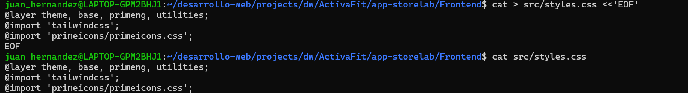
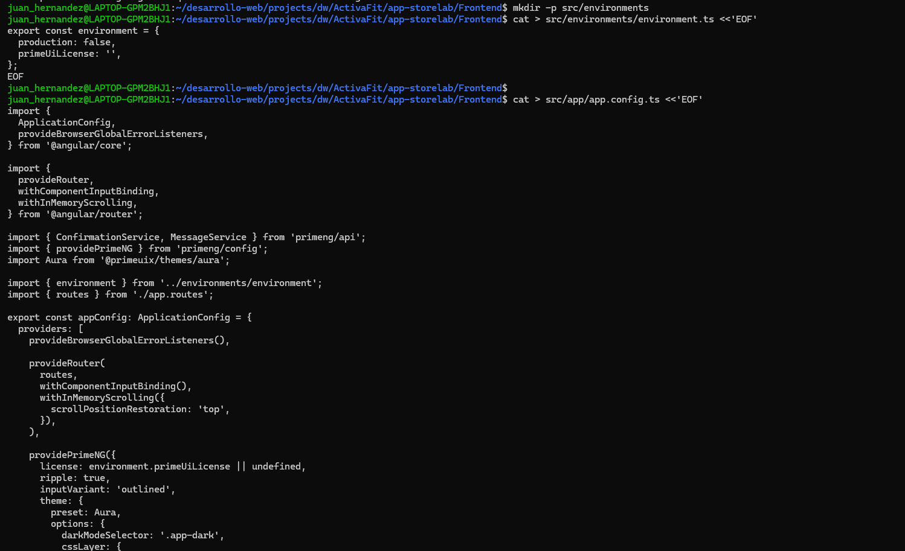
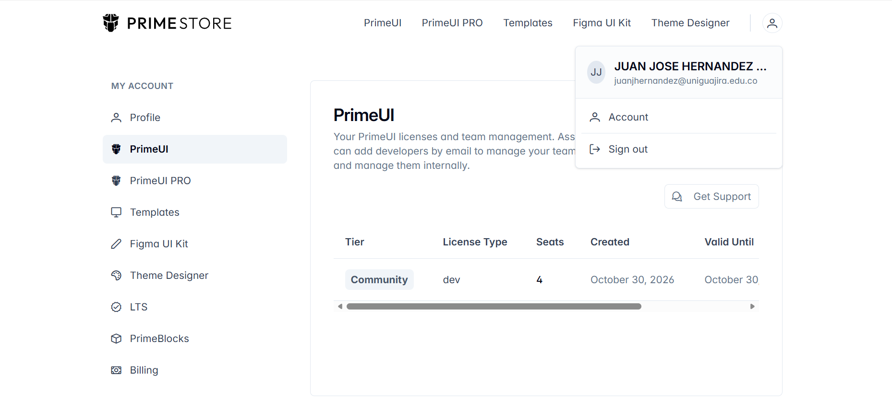
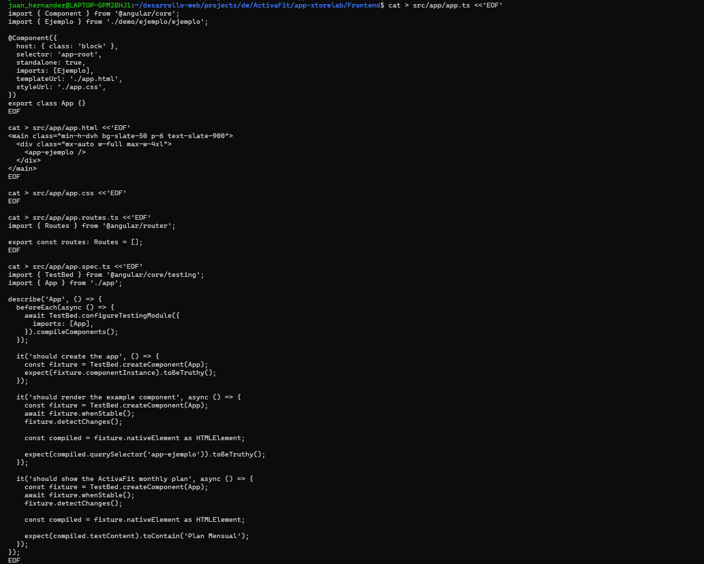
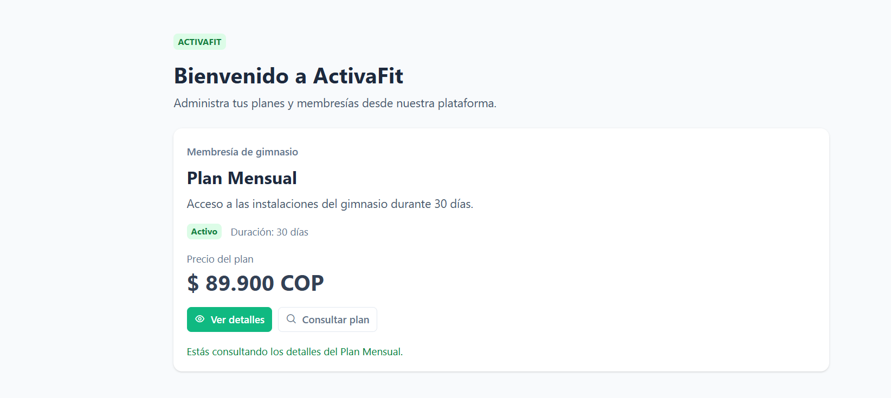
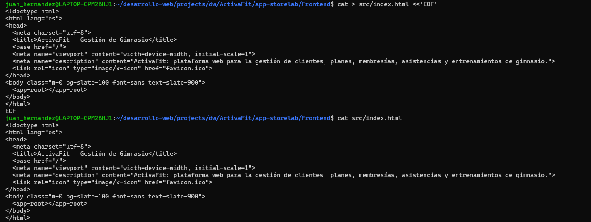
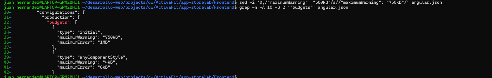
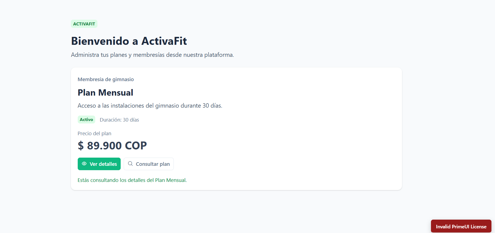
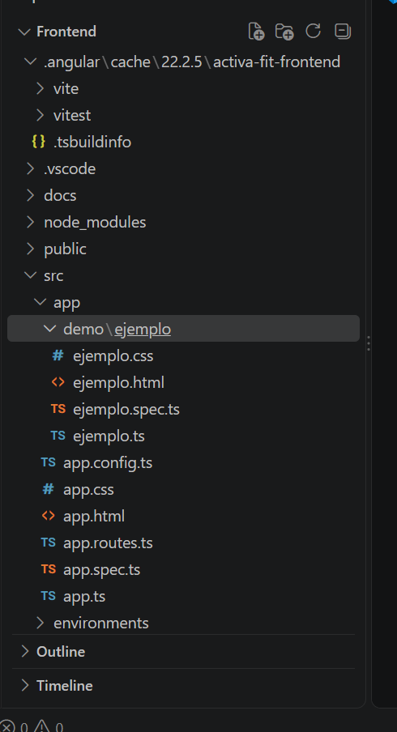
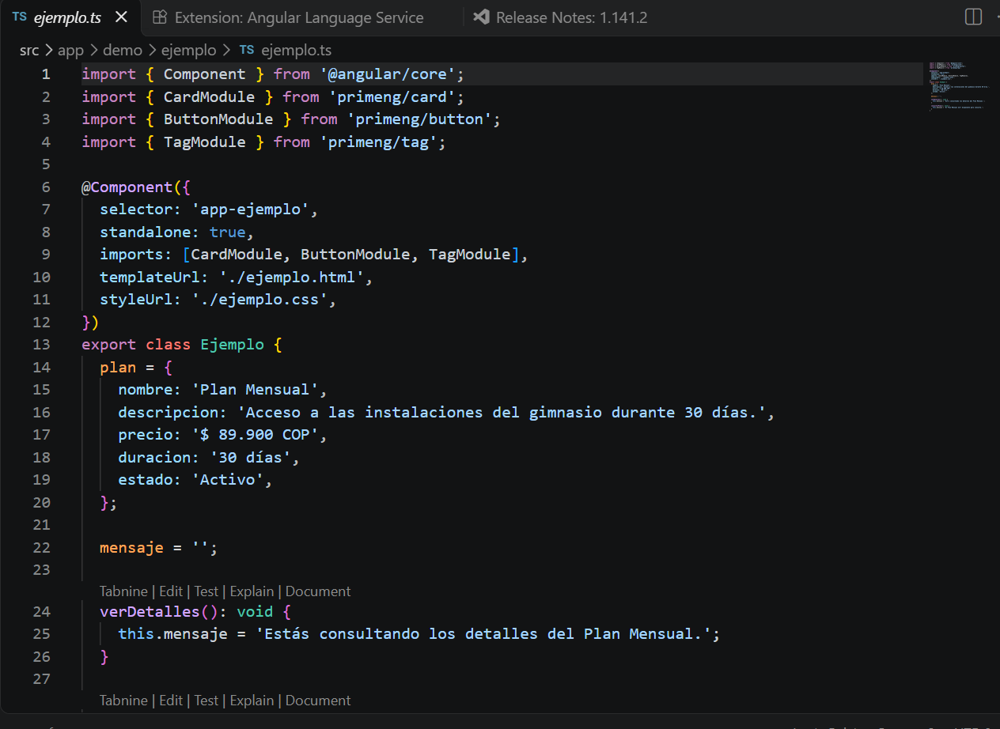

# ActivaFit - Frontend

# **0. ISS-00 — Requisitos previos**

## **0.1 Node, npm y Angular CLI**

## **0.2 Backend en marcha (preparación para integrar HTTP)**

## **0.3 Login y permisos**

## **0.4 Credenciales del seeder**

## **Verificación del ISS**

# **1.ISS-01 · Bootstrap Angular 22 con CLI, Tailwind y PrimeNG**

## **1.1 Crear el proyecto en la carpeta actual**

## **1.2 Instalar PrimeNG compatible con Angular**

## **1.3 Estilos globales**

## 1.4 Configurar PrimeNG

### 1.4.1 Licencia de PrimeNG 22 

## 1.5 Pantalla de arranque

## 1.6 Personalizar 

## 1.7 Ajustar el presupuesto de build

## 1.8 Primera ejecución

## 1.9 Anatomía del componente

### 1.9.3 Leer `ejemplo.ts` línea a línea

