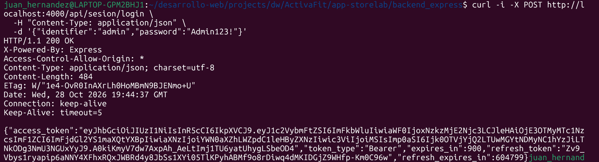
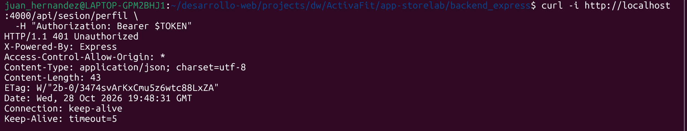
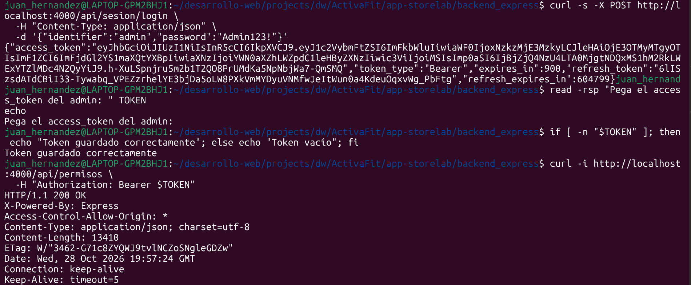
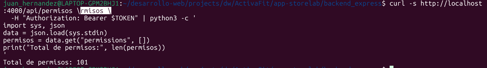

# ActivaFit - Frontend

# **0. ISS-00 — Requisitos previos**

## **0.1 Node, npm y Angular CLI**

## **0.2 Backend en marcha (preparación para integrar HTTP)**

## **0.3 Login y permisos**

## **0.4 Credenciales del seeder**

